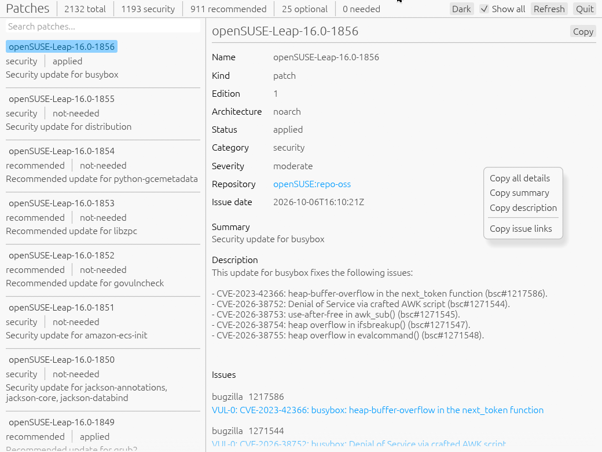

# zypi

## Zypper patch infos
A small desktop viewer for patches `zypper` knows about on openSUSE and SLE
systems. It only reads information from the system; it never installs, removes or refreshes anything.

It runs `zypper --xmlout lp` in the background and
displays the current information, so everything zypper reports about a
patch is available. This works as an ordinary user; no root privileges are needed and none are requested.
Fields that zypper omits are shown as `Unknown`, `Uncategorized` or
`Unspecified` rather than being left blank.
Patches with status `needed` are highlighted in red and appear on top of the patch list.


### UI description

The window is split into a toolbar, a patch list on the left and a details pane
on the right.

<p>

</p>

#### Toolbar pane

The left side of the toolbar shows some statistics for the currently loaded patches:

- `total` number of patches in the list
- `security`, `recommended`, `optional` number of patches per category
- `needed` number of patches that are still pending to be installed on this
  system. The counter turns red as soon as at least one patch is needed.

The buttons on the right side have the following function:

- `Dark` / `Light` is switching between the dark and the light theme. The
  button label always names the theme you switch to.
- `Show all` when checked (this is the default), all patches known to zypper are
  listed, including those already applied or not relevant for this system. 
  If unchecked, only the patches zypper considers
  applicable are listed. Changing the checkbox reloads the list.
- `Refresh` runs `zypper` again and reloads the patch list. The current
  selection is kept if the patch is still present. This does *not* refresh the
  repository metadata, see [Runtime Requirements](#runtime-requirements).
- `Quit` closes the application.

#### Patch list pane

The left pane lists the patches. Each entry shows:

- the patch name, e.g. `openSUSE-Leap-16.0-1856`
- the category (`security`, `recommended`, `optional`, …) and the status
  (`needed`, `applied`, `not-needed`, …). A `needed` status is shown in red.
- the one-line patch summary

Patches with status `needed` are sorted to the top. All other patches follow,
grouped by name and with the newest patch number first. Click an entry to show
its details in the details pane. The width of the list can be changed by
dragging the border between the list and the details pane.

The `Search patches...` field above the list filters the entries while you
type. The search is case-insensitive and a patch is shown if

- its name, summary or description contains the search text, or
- its category or status starts with the search text.

For example, `need` shows all patches having needed as category, `sec` shows all security
patches and `CVE-2026-38752` finds the patch fixing that CVE.


#### Details pane

The right pane shows all information zypper provides for the selected patch:

- `Name`, `Kind`, `Edition`, `Architecture`, `Status`, `Category` and `Severity` of the patch
- `Repository` the alias of the repository providing the patch. Clicking
  it opens the repository URL in the web browser.
- `Issue date` the release date of the patch
- `Summary` and `Description`  the patch description, usually
  listing the fixed issues
- `License` only shown if the patch contains license information
- `Issues` all bug reports and CVEs referenced by the patch with their
  type (e.g. `bugzilla`, `cve`), id and title. Clicking a title opens the bug
  report or CVE page in the web browser.

The `Copy` button next to the patch name copies all information as plain text to
the clipboard. Right-clicking anywhere in the details pane opens a context menu
with more copy options:

- `Copy all details` does the same as the Copy button
- `Copy summary` copy name, category, severity, issue date and summary to the clipboard
- `Copy description` copy only the description text
- `Copy issue links` copy the URLs of all referenced issues, one per line to the clipboard if there are any in the patch.

### Build

```sh
cargo build --release
./target/release/zypi
```

To run the XML deserialization test, use `cargo test`.

Rust **1.95 or newer** is required due to the minimum supported Rust version of egui/eframe.


### Runtime Requirements


- The `zypper` command in `PATH`. It is installed by default on openSUSE and SLE systems.
- Meaningful results need up-to date zypper repository metadata. Refreshing needs root,
  so run `sudo zypper refresh` occasionally. No refresh of the metadata is done by zypi.
- A graphical session, either Wayland or X11.

